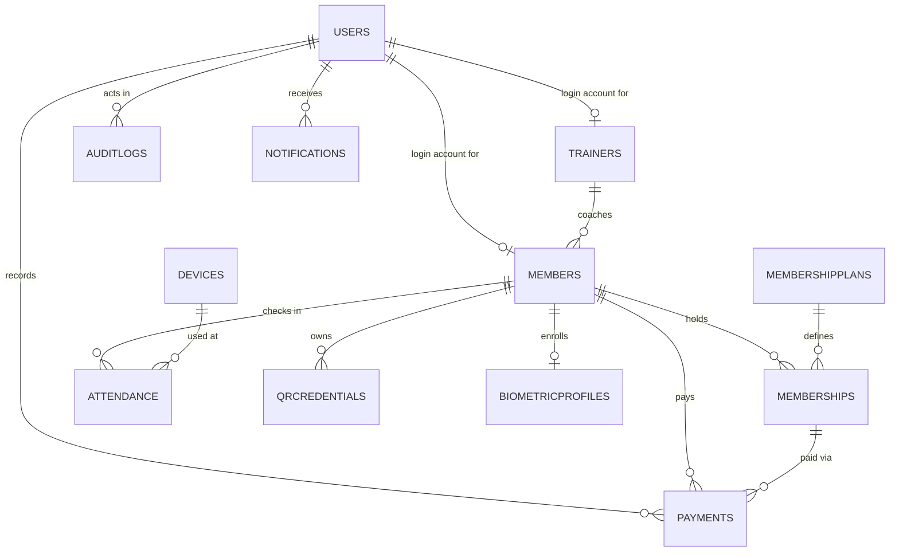

# Database Design — Smart Gym Management System

MongoDB with Mongoose ODM. All collections use `timestamps` (`createdAt` / `updatedAt`).
Relationships use ObjectId references; no data is duplicated across collections except
denormalized display snapshots inside API responses (computed at read time, never stored).

## Entity Relationship Diagram

## Collections

### 1. users
Login accounts for every role: `super_admin`, `gym_admin`, `receptionist`, `trainer`, `member`.
Fields: name, email (unique), passwordHash (bcrypt, never serialized), role, isActive,
refreshTokens (hashed, rotated), passwordResetTokenHash + expiry, lastLoginAt.

### 2. members
Gym member profiles. Fields: memberId (unique, auto `GYM-0001`), optional user link,
fullName, profilePicture, email (unique), phone, gender, dateOfBirth, address,
emergencyContact, registrationDate, assignedTrainer → trainers, status
(active/inactive/suspended), faceEnrolled flag.

### 3. trainers
Trainer profiles. Fields: trainerId (auto `TRN-0001`), optional user link, fullName,
email (unique), phone, specialization, experienceYears, salary (admin-only, `select: false`),
profileImage, availability, isActive.

### 4. membershipPlans
Sellable plans: name (unique), planType (daily/weekly/monthly/quarterly/half_yearly/yearly/custom),
durationDays, price, features[], status.

### 5. memberships
One row per plan assignment. member → members, plan → membershipPlans, startDate,
expiryDate, status (active/expired/suspended/cancelled — "expired" is also computed
from expiryDate at read time), pricePaid, isCurrent (exactly one current membership
per member; assigning a new plan closes the previous one).

### 6. attendance
Check-in/check-out sessions AND rejected attempts. member → members, checkInAt,
checkOutAt, date (YYYY-MM-DD), method (QR/FACE/MANUAL), status (checked_in/checked_out),
verificationResult (success/rejected), rejectionReason, entryDevice → devices,
faceDistance (match quality for face check-ins). An active session = status
`checked_in` + result `success`; gym occupancy counts these. A member can never have
two active sessions — enforced in the check-in service.

### 7. qrCredentials
One active credential per member. tokenHash (SHA-256 of the token, unique — the raw
token itself is never stored in plaintext), encryptedToken (AES-256-GCM encrypted
copy used only so the member portal can re-render the QR image), status
(active/revoked), revokedAt, lastUsedAt.

### 8. biometricProfiles
One per member (unique). encryptedDescriptor — the averaged 128-dimension face
template, AES-256-GCM encrypted at rest, `select: false`, stripped by toJSON.
samplesCount, consentGiven, consentAt, status (active/deleted), enrolledBy.
Deleting a profile overwrites the template material and clears consent.

### 9. payments
paymentId (auto `PAY-00001`), member → members, membership/plan links, amount,
discount, method (cash/bank_transfer/card/other), status
(pending/completed/failed/refunded), transactionReference, paidAt, recordedBy → users.
A payment counts toward revenue only when `completed`.

### 10. notifications
recipient → users (optional), audience (staff/member/user), member link, type
(membership_expiring, payment_received, check_in_success, check_in_rejected,
new_member, …), title, message, isRead. Delivered in real time over Socket.IO.

### 11. auditLogs
actor → users, action (e.g. `member.create`, `face.enroll`, `qr.revoke`), entity,
entityId, details (mixed), ip. Written for all sensitive operations; failures in
audit writing never break the main request.

### 12. devices
Registered entrance hardware: name, location, type (qr_scanner/face_terminal/
reception_desk/other), deviceKey (random), isActive, lastSeenAt (updated on each
verification from that device).

## Indexes

- users.email (unique), users.role
- members.memberId (unique), members.email (unique), members.status, members.assignedTrainer
- trainers.trainerId (unique), trainers.email (unique)
- membershipPlans.name (unique)
- memberships: { member, isCurrent }, expiryDate, status
- attendance: { member, status, verificationResult }, { date, verificationResult }, checkInAt
- qrCredentials.tokenHash (unique), member, status
- biometricProfiles.member (unique)
- payments.paymentId (unique), member, status, paidAt
- notifications.recipient, audience, isRead
- auditLogs.actor, action, entity
- devices.deviceKey (unique)

## Key integrity rules (enforced in services, not just the UI)

1. Entry requires: member account active + current membership active and unexpired.
2. Duplicate active check-in sessions are impossible.
3. QR tokens are random, hashed at rest, and revocable; regenerating revokes the old one.
4. Face matching happens server-side against decrypted templates; descriptors are
   never returned by any API.
5. Revenue aggregates only include `completed` payments.
